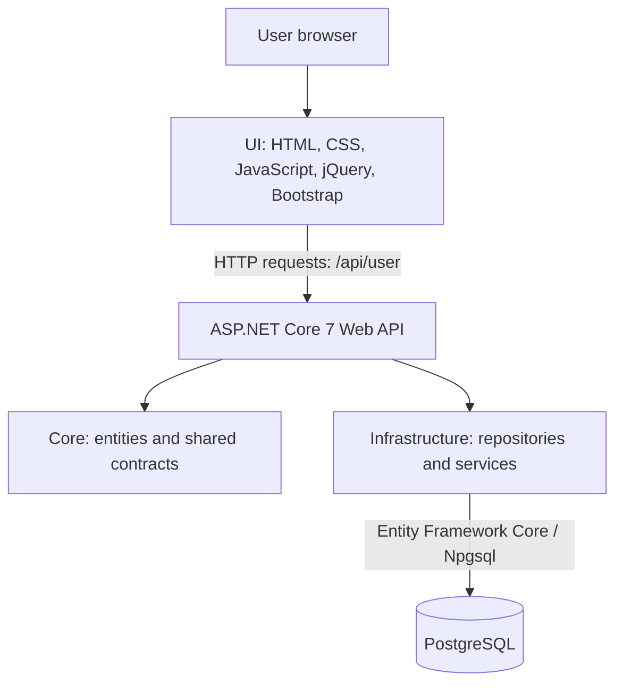

# Basic 3-Tier Application

A simple user-management application that demonstrates a three-tier architecture: a browser-based UI, an ASP.NET Core Web API, and a PostgreSQL database.

The project is useful for learning how application layers communicate and how to package the UI and API in Docker containers.

## What the application does

The UI lets a user:
- View users in a table.
- Add a user.
- Edit an existing user.
- Delete a user.

The API exposes the user operations under the `/api/user` route. The API uses Entity Framework Core and the Npgsql PostgreSQL provider for database access.

## Architecture



### Layers in plain English

| Layer | Responsibility |
|---|---|
| UI | Displays users and sends HTTP requests to the API. |
| API | Receives HTTP requests, configures services, applies CORS and maps controllers. |
| Core | Contains shared domain types, including the `User` entity. |
| Infrastructure | Implements data-access and application services. |
| Database | Stores user records in PostgreSQL. |

## Technology stack

- **Frontend:** HTML, CSS, JavaScript, jQuery, Bootstrap 4
- **Backend:** C#, ASP.NET Core 7 Web API
- **Data access:** Entity Framework Core 7
- **Database provider:** Npgsql for PostgreSQL
- **API documentation:** Swagger / Swashbuckle
- **Web server / containers:** Nginx for the UI, Docker for container images

## Repository layout

```text
.
├── api/
│   ├── Basic3TierAPI/          # ASP.NET Core API and controllers
│   ├── Basic3Tier.Core/        # Domain entities and shared core code
│   └── Basic3Tier.Infrastructure/ # Data access and service implementations
├── ui/
│   ├── config/                 # Browser-side API URL configuration
│   ├── index.html              # User-management page
│   ├── main.js                 # UI actions and API calls
│   ├── main.css                # UI styles
│   └── Dockerfile              # Nginx-based UI image
├── Dockerfile                  # Multi-stage API image build
└── docker-compose.yml          # Placeholder; local Compose orchestration is not configured yet
```

## How the request flow works

1. The browser loads the static page from the UI.
2. The UI reads `ui/config/config.json` to obtain `API_URL`.
3. The JavaScript calls the API route `/api/user`.
4. The API controller delegates work to the application service/repository layers.
5. Entity Framework Core communicates with PostgreSQL.
6. The API returns data and the UI refreshes the user table.

## Run locally

### Prerequisites

- .NET 7 SDK
- PostgreSQL
- A browser
- Docker (optional, for container builds)

> **Note:** This repository currently targets .NET 7. .NET 7 is out of support. Use this version to reproduce the current project; plan an upgrade to a supported .NET LTS release before using it for a new production deployment.

### 1. Configure the database connection

The API reads the connection string named `Basic3Tier` from configuration. You can provide it through the environment variable `ConnectionStrings__Basic3Tier`.

Example for a local PostgreSQL instance (replace the database, username and password with your own values):

```bash
export ConnectionStrings__Basic3Tier="Host=localhost;Port=5432;Database=basic3tier;Username=postgres;Password=CHANGE_ME"
```

Do not commit real passwords, tokens, or production connection strings.

### 2. Start the API

From the repository root:

```bash
dotnet run --project api/Basic3TierAPI/Basic3TierAPI.csproj
```

The API configures Swagger and runs database migrations during application startup. Make sure PostgreSQL is reachable and the database credentials are correct.

Open the Swagger UI at the local URL printed by the .NET application, followed by `/swagger`.

### 3. Configure and serve the UI

Edit `ui/config/config.json` and set `API_URL` to the base URL of the running API. Keep the trailing slash if you use a base URL such as `http://localhost:5000/`.

Then serve the `ui` directory with a local static web server, or build and run the Nginx container as described below. Open the UI URL in your browser.

## Build Docker images

Run these commands from the repository root.

### API image

The root Dockerfile uses the repository root as its build context:

```bash
docker build -t basic3tier-api:local -f Dockerfile .
```

### UI image

The UI Dockerfile packages the static files with Nginx:

```bash
docker build -t basic3tier-ui:local ./ui
```

The UI reads its API endpoint from `ui/config/config.json`. Configure that value for the environment you are deploying to before building or serving the UI.

## API endpoint

| Method | Route | Purpose |
|---|---|---|
| GET | `/api/user` | Retrieve users |
| POST | `/api/user` | Create a user |
| PUT | `/api/user/{id}` | Update a user |
| DELETE | `/api/user/{id}` | Delete a user |

The frontend currently calls these routes. Confirm the exact response schema and validation rules in the API implementation before integrating another client.

## Current project notes

- The UI is a static HTML/JavaScript application; it does not have a Node.js build step.
- The root Dockerfile builds the API from the repository root.
- The UI Dockerfile serves static files with Nginx.
- `docker-compose.yml` is currently only a placeholder, so a complete one-command local environment is not available yet.
- The API currently allows any origin through its CORS configuration. Restrict this to the intended UI origin before a production deployment.
- The repository contains a browser-side API URL configuration file. Keep environment-specific URLs non-sensitive and do not put credentials in frontend configuration.

## Learning outcomes

By working through this project, you can practise:
- Separating frontend, API, business and data-access responsibilities.
- Designing and consuming REST endpoints.
- Connecting an ASP.NET Core API to PostgreSQL with Entity Framework Core.
- Building API and UI Docker images.
- Understanding configuration and service-to-service communication.

## Future improvements

- Add a Docker Compose setup for the UI, API and PostgreSQL.
- Add health checks and automated tests.
- Restrict CORS to known frontend origins.
- Move environment-specific configuration outside the frontend image where practical.
- Upgrade the API from .NET 7 to a supported .NET LTS release.
- Add a deployment guide for the target Kubernetes or cloud environment.

---

This README describes the code and configuration currently present in the repository. Update the deployment section as the cloud/Kubernetes manifests and automation are added or verified.


## Kubernetes deployment configuration

The API Deployment reads its database connection string from a Kubernetes Secret named `basic3tier-db`. Create the Secret in the same namespace before applying the API manifest:

```bash
kubectl create secret generic basic3tier-db \
  --from-literal=connection-string='Host=postgres-service;Port=5432;Database=basic3tier;Username=postgres;Password=REPLACE_WITH_YOUR_PASSWORD'
```

Replace the example password locally. Do not commit real credentials or a populated Secret manifest.

Apply the manifests only after confirming the cluster context and namespace:

```bash
kubectl config current-context
kubectl apply -f postgres-deployment.yaml
kubectl apply -f api-deployment.yaml
kubectl apply -f ui-deployment.yaml
kubectl apply -f ui-ingress.yaml
```

The repository also contains an Azure AKS cluster configuration example in `cluster.yaml`; review the resource group, region and cluster name before using it. The API currently has permissive CORS configuration in its source code. Restrict allowed origins to the actual UI domain before any production use.
