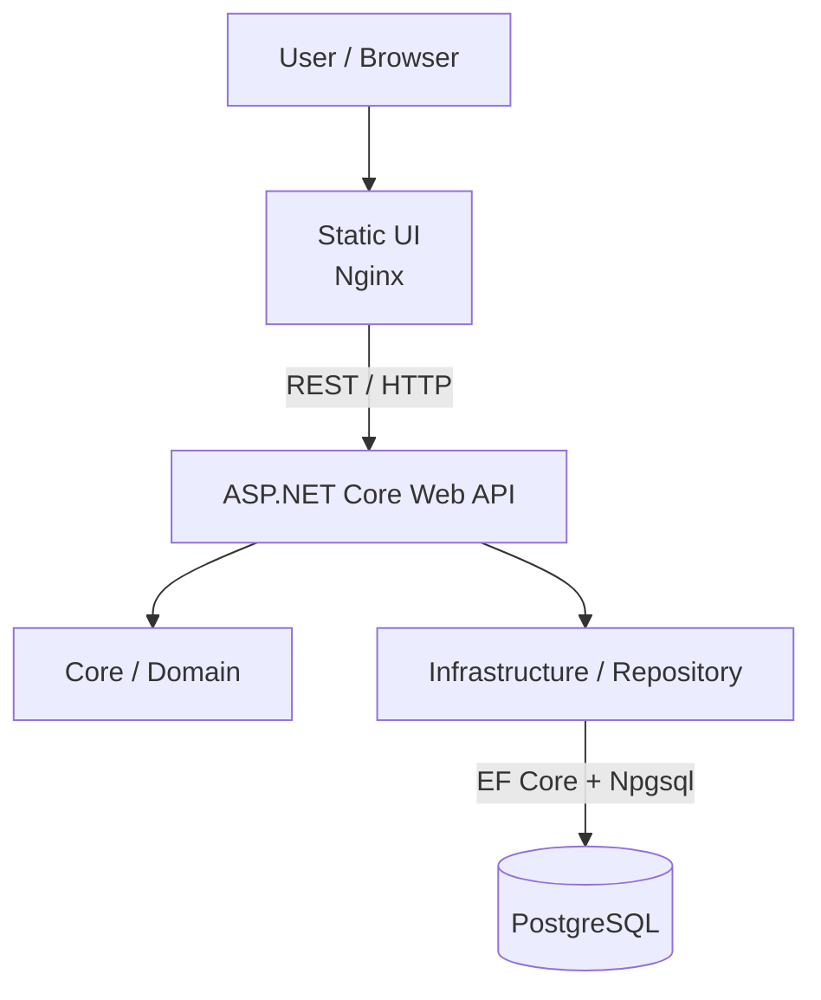

# 3-Tier User Management Application

A containerised user-management application built to practise a classic **frontend → API → database** architecture. The repository includes an ASP.NET Core Web API, a browser-based UI, PostgreSQL configuration, Dockerfiles and Kubernetes manifests.

> **Project status:** Application source and container/Kubernetes configuration are included. The Docker Compose file is still a placeholder. Kubernetes manifests require your Docker images, database Secret and cluster settings to be configured before deployment.

## At a glance

| Area | Technology |
|---|---|
| Frontend | HTML, CSS, JavaScript, jQuery, Bootstrap |
| Backend | C#, ASP.NET Core 7 Web API |
| Data access | Entity Framework Core, Npgsql |
| Database | PostgreSQL |
| Containers | Docker, Nginx |
| Orchestration | Kubernetes (manifests included) |
| Cloud learning | Azure AKS configuration example |

## Architecture



The UI sends requests to the API. The API handles user operations and uses the infrastructure layer to read and write records in PostgreSQL.

## Features

- View users in a table.
- Create a user.
- Update an existing user.
- Delete a user.
- REST API documented with Swagger.
- Separate Docker images for the API and UI.
- Kubernetes Deployment and Service manifests for the API, UI and PostgreSQL, plus an Ingress example.

## Repository structure

```text
.
├── api/
│   ├── Basic3TierAPI/             # ASP.NET Core API and controllers
│   ├── Basic3Tier.Core/           # Domain entities and shared code
│   └── Basic3Tier.Infrastructure/ # Data access and services
├── ui/
│   ├── config/                    # Browser-side API URL
│   ├── index.html
│   ├── main.js
│   ├── main.css
│   └── Dockerfile                 # Nginx UI image
├── Dockerfile                     # API image
├── api-deployment.yaml
├── ui-deployment.yaml
├── postgres-deployment.yaml
├── ui-ingress.yaml
├── cluster.yaml                   # AKS configuration example
└── docker-compose.yml             # Placeholder; not a working stack yet
```

## Run locally

### Prerequisites

- .NET 7 SDK
- PostgreSQL
- A browser
- Docker (optional)

> **Compatibility note:** This project currently targets .NET 7, which is out of support. The version is listed to reproduce this learning project; upgrade to a supported .NET release before production use.

### 1. Configure PostgreSQL

Create a local database and provide the connection string through an environment variable:

```bash
export ConnectionStrings__Basic3Tier="Host=localhost;Port=5432;Database=basic3tier;Username=postgres;Password=CHANGE_ME"
```

Use your own local credentials. Never commit real passwords or connection strings.

### 2. Start the API

From the repository root:

```bash
dotnet run --project api/Basic3TierAPI/Basic3TierAPI.csproj
```

The application applies database migrations during startup. Open the Swagger URL printed by the application, followed by `/swagger`.

### 3. Configure and serve the UI

Set `API_URL` in `ui/config/config.json` to the base URL printed by the API. Then serve the `ui/` directory with a local static web server, or build the Nginx image below.

## Build Docker images

Run from the repository root:

```bash
# API image
docker build -t rmavani/basic3tier-api:latest -f Dockerfile .
docker push rmavani/basic3tier-api:latest

# UI image
docker build -t rmavani/basic3tier-ui:latest ./ui
docker push rmavani/basic3tier-ui:latest
```

Authenticate to Docker Hub before pushing. The UI's `API_URL` must point to the API address reachable by the browser in the target environment.

## Kubernetes deployment

The manifests are examples and must be reviewed for your cluster before applying. The API and PostgreSQL deployments read credentials from a Kubernetes Secret named `basic3tier-db`.

Create the Secret first. Use the same password in both values:

```bash
kubectl create secret generic basic3tier-db \
  --from-literal=postgres-password='REPLACE_WITH_A_STRONG_PASSWORD' \
  --from-literal=connection-string='Host=postgres-service;Port=5432;Database=basic3tier;Username=postgres;Password=REPLACE_WITH_A_STRONG_PASSWORD'
```

Then check the active context and apply the manifests:

```bash
kubectl config current-context
kubectl apply -f postgres-deployment.yaml
kubectl apply -f api-deployment.yaml
kubectl apply -f ui-deployment.yaml
kubectl apply -f ui-ingress.yaml
```

Before deployment:
- Confirm the image names and tags in the manifests.
- Update the Ingress host to the hostname assigned to your ingress controller.
- Confirm the StorageClass exists in the cluster.
- Configure the UI API URL for the deployed API.
- Restrict CORS in the API to the intended frontend origin.

`cluster.yaml` is an Azure AKS configuration example; it is not a Terraform module or a guarantee that a cluster currently exists.

## API endpoints

| Method | Endpoint | Purpose |
|---|---|---|
| GET | `/api/user` | List users |
| POST | `/api/user` | Create a user |
| PUT | `/api/user/{id}` | Update a user |
| DELETE | `/api/user/{id}` | Delete a user |

Check the API implementation for the exact request and response schema.

## Current limitations and next steps

- `docker-compose.yml` is a placeholder; a complete local multi-container setup is not configured.
- The API currently allows any CORS origin. Restrict it before deployment.
- .NET 7 is out of support; plan an upgrade to a supported LTS release.
- Add automated API tests and container health checks.
- Add CI/CD to build, scan and publish images.
- Add a deployment guide and verify the Kubernetes rollout in a target cluster.

## What this project demonstrates

Layered application architecture, REST API development, PostgreSQL integration, Docker image creation, Kubernetes manifests, configuration management and basic cloud deployment concepts.


## GitHub Actions deployment workflow

The CI workflow builds the API and UI Docker images on pushes and pull requests. It publishes images to Docker Hub only for pushes to `main`; pull requests build locally without requiring registry credentials.

The EC2 deployment workflow is intentionally manual. Before running it, configure these GitHub Actions secrets:
- `EC2_HOST`
- `EC2_PRIVATE_KEY`
- `DOCKERHUB_USERNAME`
- `POSTGRES_PASSWORD`

Then open **Actions → CD Pipeline → Run workflow** and set `deploy_to_ec2=true`. The workflow keeps PostgreSQL data in a named Docker volume and does not store a database password in the workflow file. Verify EC2 SSH access, firewall rules, and the API/UI ports before deploying.
